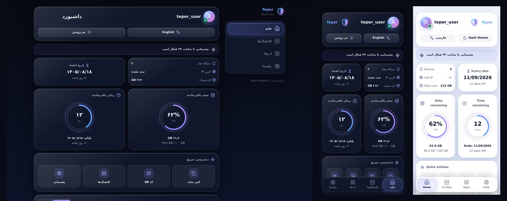

<div align="center">

# TeperTemplate

**قالب صفحه‌ی اشتراک مدرن و کاملاً قابل برندسازی برای [Pasarguard](https://github.com/PasarGuard/panel)**

Modern, fully brandable subscription page for Pasarguard



</div>

## ✨ امکانات

- طراحی شیشه‌ای (Liquid Glass) با پوسته‌ی **تیره و روشن** و ۵ رنگ تأکید
- **منوی پایین** روی موبایل و تبلت، **سایدبار** روی دسکتاپ (۴ بخش: خانه، کانفیگ‌ها، اپ‌ها، راهنما)
- **فارسی / انگلیسی** با تغییر خودکار RTL/LTR
- حلقه‌ی حجم و زمان، نمودار مصرف ۲۴ ساعته و ۷ روزه، هشدار اتمام حجم یا زمان
- **عکس پروفایل**: کاربر با لمس آواتار می‌تواند عکس بگذارد (فقط روی دستگاه خودش ذخیره می‌شود)
- حلقه‌های نازک چرخان دور حلقه‌ی حجم و زمان و جلوه‌ی براق خیلی ملایم روی کارت‌ها
- کد **QR** و کپی با یک لمس، جستجو در کانفیگ‌ها، اتصال سریع به اپ
- **کاملاً آفلاین**: آیکون‌ها و QR داخل خود فایل‌اند و CDN لازم نیست (فقط فونت وزیرمتن در حالت آنلاین لود می‌شود و در غیر این صورت فونت سیستم استفاده می‌شود)
- ایمن: همه‌ی داده‌های پنل escape می‌شوند و لینک‌های خطرناک (`javascript:` و …) حذف می‌شوند
- **برندسازی هنگام نصب**: نام برند داخل لوگو، شعار، لوگوی دلخواه، لینک پشتیبانی، رنگ و زبان
- **آپدیت با یک دستور** از روی سرور، بدون از دست رفتن برندسازی

## 🚀 نصب

روی سرور پاسارگاد (با کاربر root یا با sudo):

```bash
curl -fsSL https://raw.githubusercontent.com/Jyavaz68/TeperTemplate/main/install.sh -o install.sh && sudo bash install.sh
```

منوی نصب باز می‌شود:

```
  1  Install
  2  Update            (keeps your branding)
  3  Change branding   (name, logo, colors)
  4  Status
  5  Uninstall
  0  Exit
```

در گزینه‌ی **Install** این سؤال‌ها پرسیده می‌شود (با Enter مقدار پیش‌فرض را نگه می‌دارید):

| سؤال | توضیح |
|---|---|
| Brand name | نام برند؛ داخل لوگو و بالای صفحه نمایش داده می‌شود |
| Tagline (fa / en) | شعار زیر نام برند |
| Logo image URL | لینک `https` تصویر لوگو (PNG/SVG/WebP). با `-` لوگوی پیش‌فرض (سپر با نام برند گرادیانی) استفاده می‌شود |
| Support link | `@آیدی_تلگرام` یا لینک `https` |
| Accent color | Indigo، Emerald، Rose، Amber، Sky |
| Language / Theme | زبان و پوسته‌ی پیش‌فرض |

نصب‌کننده خودش `CUSTOM_TEMPLATES_DIRECTORY` و `SUBSCRIPTION_PAGE_TEMPLATE` را در `/opt/pasarguard/.env` تنظیم می‌کند، از قالب قبلی شما پشتیبان می‌گیرد و پاسارگاد را ریستارت می‌کند. بعد از نصب دستور **`teper`** هم ساخته می‌شود.

## 🔄 آپدیت

وقتی نسخه‌ی جدیدی در گیت‌هاب منتشر شد، روی سرور:

```bash
teper update
```

یا از منوی `teper` گزینه‌ی **2) Update** را بزنید. نسخه‌ی نصب‌شده با نسخه‌ی گیت‌هاب مقایسه می‌شود، تغییرات نسخه نشان داده می‌شود، فایل قبلی در `.teper-backups` نگه داشته می‌شود و **برندسازی شما دست‌نخورده می‌ماند**.

## ⚙️ نصب بدون پرسش (اتوماتیک)

```bash
sudo bash install.sh install --yes \
  --name "My Brand" --subtitle-fa "پنل اشتراک" --subtitle-en "Subscription" \
  --logo https://example.com/logo.png --support @my_support \
  --accent emerald --lang fa --theme dark
```

همه‌ی گزینه‌ها: `bash install.sh --help`

## 🧩 نصب دستی

1. فایل `index.html` را در `/var/lib/pasarguard/templates/subscription/index.html` بگذارید.
2. در `/opt/pasarguard/.env` این دو خط را تنظیم کنید:
   ```
   CUSTOM_TEMPLATES_DIRECTORY="/var/lib/pasarguard/templates/"
   SUBSCRIPTION_PAGE_TEMPLATE="subscription/index.html"
   ```
3. `pasarguard restart`
4. برندسازی دستی: بلوک `window.TEPER_CONFIG` بالای `index.html` را ویرایش کنید.

## 🛠 برای ناشر (انتشار در گیت‌هاب)

1. ریپازیتوری **TeperTemplate** را بسازید و همه‌ی فایل‌ها را آپلود کنید.
2. نصب‌کننده روی ریپازیتوری `Jyavaz68/TeperTemplate` (شاخه‌ی `main`) تنظیم شده است. اگر اسم کاربری یا شاخه فرق دارد، مقدار `GH_USER` و `BRANCH` را در بالای `install.sh` عوض کنید.
3. **برای هر آپدیت:** فایل `index.html` را تغییر دهید، عدد داخل `VERSION` را بالا ببرید (مثلاً `1.0.1`) و یک بخش در `CHANGELOG.md` اضافه کنید. کاربران با `teper update` نسخه‌ی جدید را می‌گیرند.
4. اگر نمی‌خواهید نوشته‌ی «ساخته‌شده با TeperTemplate» پایین صفحه دیده شود، در `window.TEPER_CONFIG` مقدار `"credit": false` بگذارید.

### شخصی‌سازی اپ‌های پیشنهادی

داخل `TEPER_CONFIG` می‌توانید اپ پیشنهادی هر سیستم‌عامل را عوض کنید:

```js
"recommended": { "android": { "name": "Hiddify", "url": "https://…", "store": "GitHub" } }
```

## 🗑 حذف

`teper` ← **5) Uninstall**. قالب قبلی شما برمی‌گردد.

## ℹ️ نکات

- پیام‌های ترمینال نصب‌کننده انگلیسی است (نمایش فارسی در بسیاری از ترمینال‌ها درست نیست)؛ اما نام برند و شعار فارسی را بدون مشکل می‌پذیرد.
- قالب فقط از endpointهای خودِ صفحه‌ی اشتراک (`/info`، `/apps`، `/links`، `/usage`) داده می‌گیرد و هیچ داده‌ای به سرور دیگری نمی‌فرستد.
- اگر در پنل شما لیست کانفیگ‌ها از `/links` نیاید، بخش «کانفیگ‌ها» لینک اشتراک را نشان می‌دهد و خالی می‌ماند.

## 📄 مجوز

MIT — فایل `LICENSE`
